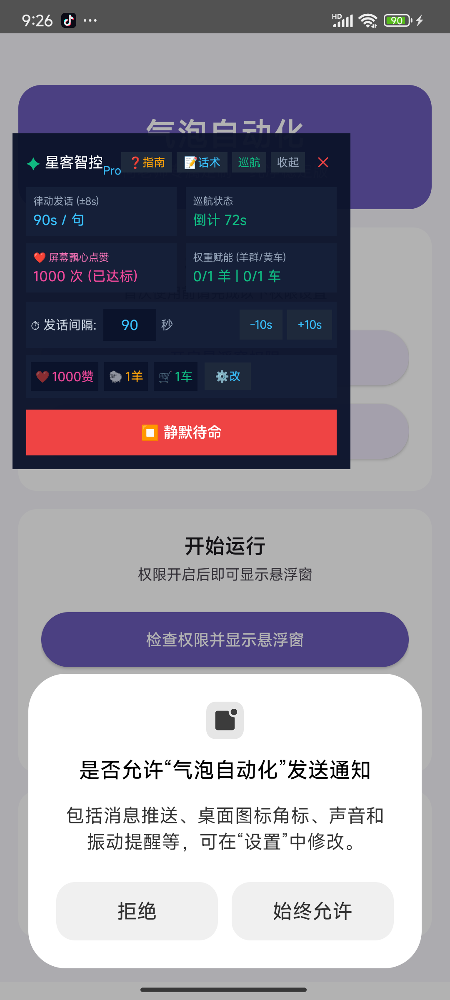
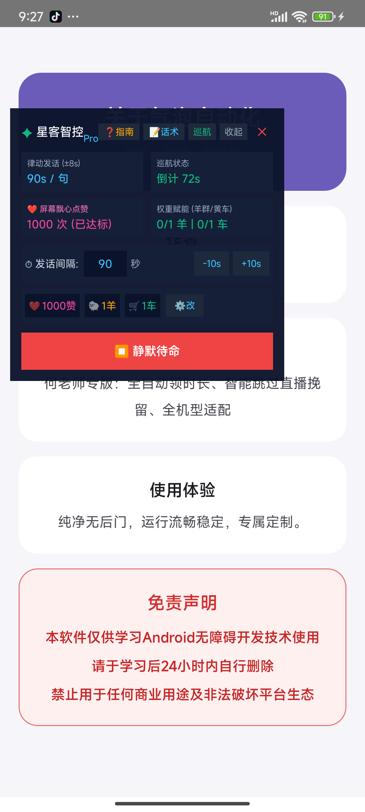
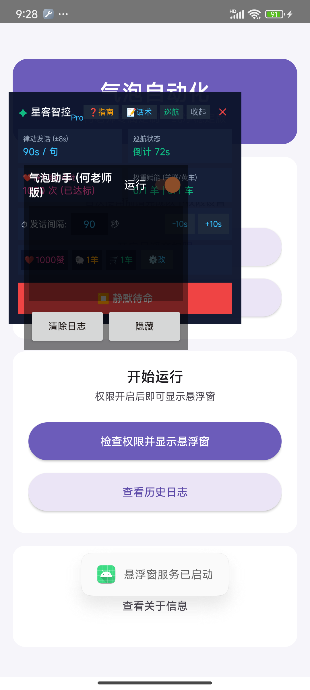

# 气泡自动化 · 何老师专属定制纯净版 (QipaoAuto)

<p align="center">
  
  
  
  
</p>

> 🚀 **基于 Android Accessibility（无障碍）服务的纯净无后台自动化工具**  
> 专为汽水音乐听歌时长全自动领取设计，智能跳过直播挽留、去广告、彻底移除远程更新弹窗与后门，支持国民级主流安卓全机型（小米/红米/华为/荣耀/vivo/OPPO 等）。

---

## 📥 立即下载最新版

* 📦 **最新 Release APK 下载**：[点击前往 GitHub Releases 下载 v1.0.6 定制版](https://github.com/9499758-wq/qipao-auto/releases/latest)
* ⚡ **直链极速下载**：[qipao-auto-v1.0.6-he-laoshi.apk](https://github.com/9499758-wq/qipao-auto/releases/download/v1.0.6/qipao-auto-v1.0.6-he-laoshi.apk)

---

## ✨ 核心定制与重构特性

| 特性项 | 原版表现 | 何老师专属定制版 (v1.0.6) |
|---|---|---|
| **品牌与作者** | 葫芦侠原作者信息残留 | **全局重塑为【何老师】**，纯净无冗余广告 |
| **远程更新机制** | 强制联网检测，频繁弹升级失败窗口 | **彻底拔除远程更新代码 (`checkForUpdate`)**，离线安全无弹窗骚扰 |
| **直播间挽留阻断** | 误入直播间后卡死，无法自动退出 | **智能识别直播间与挽留弹窗**，全自动返回并继续轮播广告 |
| **多广告循环接管** | 弹窗领取后无法无缝衔接下一条广告 | **优化倒计时等待与领取状态机**，稳定挂满 30 天时长 |
| **机型兼容性** | 仅部分机型能跑，MIUI/澎湃易误报 | **支持 Android 7 ~ 15 全系列**，4 字节对齐，注入 v1+v2+v3 完整数字签名 |

---

## 📱 运行效果截图

<p align="center">
  
  
  
</p>

---

## 🛠️ 使用指南

1. **安装 APK**：
   - 下载并安装 `qipao-auto-v1.0.6-he-laoshi.apk`。
   - 若系统提示“允许未知来源应用安装”，点击允许即可。
2. **授予必要权限**：
   - **开启悬浮窗权限**：允许本应用在其他应用上层显示控制面板。
   - **开启无障碍服务**：进入手机【系统设置】->【无障碍】->【已下载的应用】，找到【气泡自动化 (何老师定制版)】并开启。
3. **启动挂机**：
   - 点击主界面的【检查权限并显示悬浮窗】。
   - 切换至汽水音乐打开广告任务，气泡自动化助手将自动接管、倒计时、领取奖励并轮巡下一个任务。

---

## 🏗️ 开发者本地构建指南

本项目已整理为完整的工程结构，支持使用 `apktool` 本地一键回编译与签名：

```bash
# 1. 克隆本仓库
git clone https://github.com/9499758-wq/qipao-auto.git
cd qipao-auto

# 2. 赋予构建脚本权限并执行打包
chmod +x build.sh
./build.sh

# 3. 构建产物输出于 dist/ 目录：
# dist/qipao_he_laoshi_v106.apk
```

### 目录结构说明

```
qipao-auto/
├── app_src/                # 可直接回编译的 Apktool 资源与 Smali 源码工程
│   ├── AndroidManifest.xml # 清单文件 (已适配 targetSdk 34 与手势权限)
│   ├── res/                # UI 布局、文字与样式资源
│   ├── smali*/             # 核心业务逻辑与修复补丁
│   └── apktool.yml         # 构建配置文件
├── java_src/               # 反编译出的高质量 Java 源码 (方便检索与学习)
│   └── sources/ansheng/qipao/
│       ├── AutoAdService.java       # 无障碍核心广告与手势自动化服务
│       ├── FloatWindowService.java  # 控制台悬浮窗服务
│       ├── MainActivity.java        # 主控制界面
│       └── AboutActivity.java       # 关于页面
├── docs/                   # 项目文档与真机运行截图
│   └── screenshots/
├── build.sh                # 一键编译与签名脚本
└── README.md               # 项目使用说明
```

---

## ⚖️ 免责声明

本工程所有代码及相关产物仅供学习 Android 无障碍开发技术、逆向工程与自动化测试使用。请于学习后 24 小时内自行删除。禁止用于任何商业用途及非法破坏平台生态。使用者因违规使用造成的一切后果均由使用者自行承担，与本项目贡献者无关。

---

## 📄 开源许可证

本项目基于 [MIT License](LICENSE) 许可开源。
